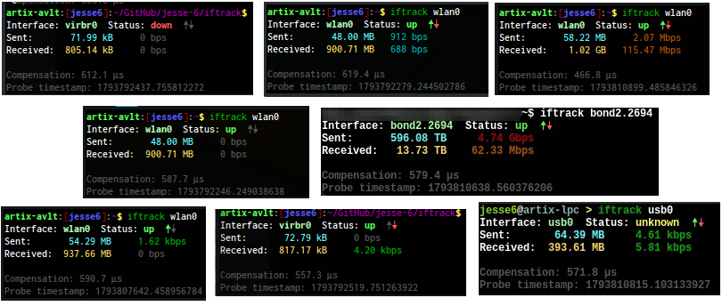

# Interface live statistics tracker utility - for Linux x86-64 systems

<p align="center">
    
</p>


This simple command line utility can be used to show per second simple live statistics for a given network interface, whose name is specified as its only parameter. It tracks state, total transmitted and received data and current transmit and receive bandwidth usage. It also maintains a live database with the same data for integration with other appliances. See below.

### Usage

```> iftrack interface```

Where interface is the interface name. One can run 'iftrack' without parameters to see a list of currently available interfaces that can be tracked.

### Install

Just copy the binary 'iftrack' file to your preferred binary location (e.g., '/usr/bin', for system-wide, or '~/.local/bin' for user restricted availability), and run it as specified above.

### Uninstall

Just remove the binary from the location you've copied previously. That's it. ;)

### Script support for gathered data

This application, when running, creates and updates a tmpFS entry for the specified interface, with all processed data formatted for exhibition. So, one can run it (as a service or not), for example: 'iftrack eth0 2>/dev/null', so it now runs silently, and maintains an entry with data from 'eth0' interface at '/tmp/iftrack/eth0' folder.
Those files can be read by a script, or an application, and be reused by them, for example, as data for dwm-like window managers status bar about that interface. Data is already formatted exactly as shown by 'iftrack' application itself.

### Environment options

As of version 0.1.X, now some configuration parameters are supported by setting specific environment variables prior to run this application. They are as follows, considering 'default' behavior as if they are not specified:

 **IFTRACK_DEBUG_ENABLE** -> enable debug string (1), or disable (0); default: now debug string related to calibration and poll timestamp is default disabled (0).
 
 **IFTRACK_TMPFS_TRACK** -> enable tmpFS files with statistics information (1), or disable (0); default: enabled (1)
 
 **IFTRACK_PREFIX_BASE** -> it controls how data will be accounted, processed and displayed: default is '1024', which means "base 1024", which is the standard (machine friendly) way of accounting bytes and bits on computers and networks, regarding metric prefixes. Account will the XB and Xbps, for total and speed, respectively. One may prefer accounting those data with human friendly accounting, so there is a '1000' parameter (meaning "base 1000"), which in turn accounts data as XiB and Xibps. There's also a case insensitive 'hybrid' parameter, which accounts total as "base 1024", and speed as "base 1000", used in some modern applications (e.g., Netspeed widget on SonicDE/Plasma). 'X' here means any metric prefix, like 'k' for kilo, 'M' for mega, 'G' for giga and so on.
 
 **IFTRACK_FIXED_BIAS** -> to ensure maximum measurement precision, which is veeeeeeeeeery challenging on Linux userspace (runlevel 3), this application has 2 bias algorithhms running: one dynamic, and one fixed. The dynamic algorithm is always on, compensating for execution latency/wobble many causes, such as task switch, variable CPU clocks, kernel parameters, kernel efficiency, switch back to this application thread delays, priority, and poll execution run length itself. It does a good job, but there is still a wobbling when returning from nanosleep() call (used in poll loop), which can't be measured beforehand. So, the fixed bias compensates for this delay, and it also varies from system to system. So this parameter may be used by the power user to ensure that the timestamp for each reading is as close as possible to an exact 1 second delay. Common user might prefer to leave it default, which is already doing quite OK, according to my personal tests over some systems out there. To adjust this value, if one is not satisfied with stock precision and wants more: enable debug, and then watch for the timestamp value on each read. Evaluate carefully for a while and then: if it is drifting above, raise the value; if it is drifting below, lower the value. Default value is at 'loop_cal' variable at source code, in seconds there. Here, **it should be in millisseconds**. Default value is (as of 0.1.185 version): 0.09846ms. Environment parameter format: N.NNNNNms.
 
#### Usage example 1:

Show statistics for interface 'wlan0', speed as base 1000 bits per second, total as base 1024 Byte count, poll extra compensation will be 0.132456 millisseconds, and /tmp/wlan0 statistics files disabled:
```
> export IFTRACK_TMPFS_TRACK=0
> export IFTRACK_FIXED_BIAS=0.132456ms
> export IFTRACK_PREFIX_BASE=hybrid
> iftrack wlan0
```

#### Usage example 2:

Show statistics for interface 'eth0', statistics as base 1000 (total as XiB, speed as Xibps), with /tmp/eth0 statistics files, default poll extra compensation value, and timestamp/compensation debug enabled, all inline:
```
> IFTRACK_PREFIX_BASE=1000 IFTRACK_DEBUG_ENABLE=1 iftrack eth0
```

Tip: one can also use 'unset' command to purge any previously created environment variable, making that erased parameter default again.

### Compiling from source

The following are needed to compile this from source:

 - [fasm2](https://github.com/tgrysztar/fasm2 "flat assembler 2") assembler;
 - [fastcall](https://github.com/Jesse-6/fastcall "C style fastcall macro toolkit - for fasm2 assember") macro kit;
 - lld LLVM linker (optional): for smaller, less bloated executables.
 
Once one got the above properly set up, at 'sources' folder, the 'build.sh' script at fastcall macro can be used to build this binary as fine as possible, by running:

```
> build.sh iftrack
> mv iftrack ../
```


